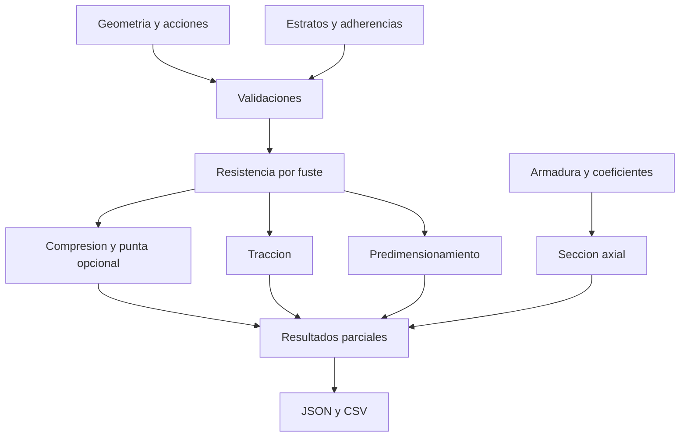

# Micropilotes | Geo_App

**Comprobacion geotecnica y estructural axial · Prototipo v0.3.0**


> [!IMPORTANT]
> No es una herramienta validada para proyecto. Las comprobaciones son parciales y requieren revision independiente y comprobacion de aplicabilidad de la guia y del marco contractual. El repositorio es publico: no introducir datos confidenciales en archivos versionados.

## Alcance
- Micropilote aislado, suelo estratificado, D nominal < 300 mm, inclinacion respecto a vertical.
- Resistencia por fuste a compresion y traccion separadas; punta opcional limitada al 15% y comprobacion numerica de condiciones de punta.
- Adherencias limite externas por CSV o entrada manual, con procedencia; seleccion de inyeccion por tramo, filtro conservador de presiones IU/IR/IRS y zona IU en primeros 5 m verticales.
- Predimensionamiento exacto por fuste con acciones constantes, sin punta ni peso favorable.
- Accion de rozamiento negativo de calculo aportada externamente, sin estimacion propia.
- Seccion tubular axial opcional sin barras adicionales, con seleccion parcial de dimensiones comerciales y entrada personalizada, reduccion radial por corrosion, factores de union, ejecucion y pandeo, y limites certificados de union opcionales.
- Calidades S235, S275, S355, S550, J55, K55 y N80 con limite elastico, resistencia a traccion y alargamiento de la tabla del catalogo Comercial de Sondeos (pagina 03). La seleccion es informativa: se debe introducir el limite elastico certificado por separado y confirmar disponibilidad para cada dimension.
- Tabla de aprovechamientos parciales, resistencia acumulada y contribucion por tramos, exportacion JSON/CSV.

## Metodologia
Referencia: [Guia para el proyecto y la ejecucion de micropilotes en obras de carretera, DGC, octubre 2005](https://cdn.transportes.gob.es/portal-web-transportes/carreteras/normativa_tecnica/08.1_guias_tecnicas/0710200.pdf).
Consulte [auditoria tecnica](docs/AUDITORIA.md), [hoja de ruta](ROADMAP.md) e [historial](CHANGELOG.md).

## Flujo


## Instalacion
Desde la raiz del repositorio:
```bash
cd micropilotes
python -m pip install -r requirements.txt
python -m streamlit run app.py
```
Para Streamlit Community Cloud: rama main, fichero micropilotes/app.py.

## Pruebas
```bash
cd micropilotes
python -m unittest discover -s tests -v
python -m compileall -q .
```
Las pruebas incluidas contrastan expresiones con calculos sinteticos independientes y limites; no equivalen a validacion fisica o normativa integral. Consultar el estado real de ejecucion en GitHub Actions si esta disponible.

## Intercambio
CSV UTF-8 separado por comas: inicio_m,fin_m,inyeccion,iu_kPa,seleccion_kPa,pi_kPa,plim_kPa,activo,nombre. Inyeccion IU, IR o IRS por tramo; para IU se usa iu_kPa. Profundidad vertical y presiones en kPa. activo true/false. Un CSV anterior sin columna inyeccion usa la inyeccion inicial seleccionada en la barra lateral para todas las filas y muestra un aviso para su revision. La aplicacion descarga una plantilla sintetica. El JSON de salida conserva entradas y resultados; la recarga de proyectos queda pendiente.

## Limitaciones
No se calculan asientos, estabilidad global, arrancamiento de un cono, flexion/cortante, cargas laterales, grupos, empotramiento en roca, conexiones al encepado ni rozamiento negativo de forma automatica. La justificacion de corrosion, pandeo, presiones por fases, ensayos y uniones sigue a cargo del proyectista. El catalogo contiene una seleccion parcial de dimensiones nominales y calidades de referencia de Comercial de Sondeos; no acredita combinaciones de dimensiones y calidades, existencias ni resistencia de uniones. No se reproducen cargas admisibles del catalogo.

**Geo_App · Ingenieria geotecnica y herramientas de calculo**
