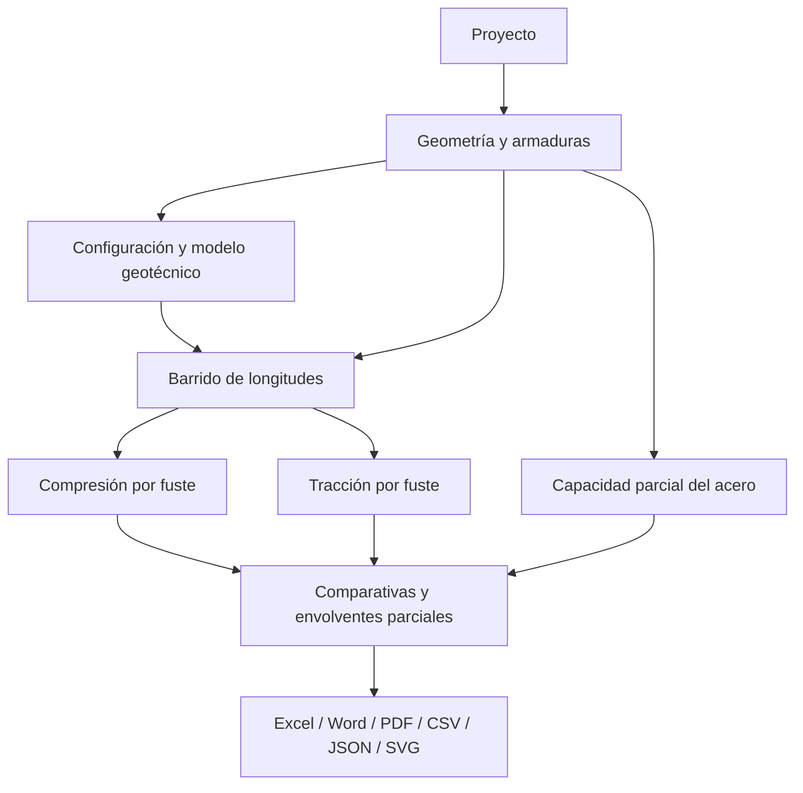

# Geo_App | Micropilotes

**Diseño paramétrico axial de micropilotes mediante correlaciones empíricas**


[](https://github.com/me1lopig/Exterior/actions/workflows/micropilotes.yml)

Herramienta de predimensionamiento geotécnico para estudiar micropilotes aislados en terrenos estratificados. Define el perfil una sola vez, selecciona diámetros y armaduras comerciales, y obtiene tablas y curvas de resistencia axial frente a longitud. Las acciones de cálculo son opcionales.

> [!IMPORTANT]
> Versión de desarrollo, pendiente de validación técnica independiente. Las capacidades calculadas son parciales; no acreditan la conformidad global del micropilote ni sustituyen el criterio del proyectista. Revisar la aplicabilidad de la guía y la normativa de cada proyecto. No incorporar datos confidenciales de obra al repositorio público.

## Índice

- [Funcionalidades](#funcionalidades)
- [Flujo de trabajo](#flujo-de-trabajo)
- [Interfaz](#interfaz)
- [Modelo geotécnico](#modelo-geotécnico)
- [Geometría y catálogo comercial](#geometría-y-catálogo-comercial)
- [Metodología de cálculo](#metodología-de-cálculo)
- [Resultados y exportaciones](#resultados-y-exportaciones)
- [Instalación y despliegue](#instalación-y-despliegue)
- [Estructura del proyecto](#estructura-del-proyecto)
- [Pruebas y validación](#pruebas-y-validación)
- [Limitaciones y próximos pasos](#limitaciones-y-próximos-pasos)

## Funcionalidades

| Área | Prestaciones de la v0.7.2 |
|---|---|
| Geotecnia | Espesores verticales, adherencias límite directas, inyección IU/IR/IRS por tramo, Fr y fuste activo |
| Barrido paramétrico | Longitud axial mínima, máxima e incremento; inclinación y múltiples diámetros |
| Catálogo | 74 secciones CS550/CSTM80, 9 calidades de acero y sección personalizada |
| Compresión y tracción | Resultados independientes, detalle por tramo y cargas opcionales |
| Acero | Sección residual, corrosión, unión, ejecución, coacción lateral y capacidades parciales |
| Comparación | Envolventes parciales terreno–armadura y longitud de cruce |
| Gráficas | Perfil geotécnico, adherencias, contribuciones por tramo, sección transversal y curvas resistentes |
| Documentación | Excel, Word, PDF, CSV, JSON y SVG |
| Proyectos | Guardado y recuperación de entradas mediante JSON de esquemas 1 y 2 |

## Flujo de trabajo



## Interfaz

| Pestaña | Contenido |
|---|---|
| 01 · Proyecto | Identificación, autor, revisión, nuevo proyecto, guardar y abrir JSON |
| 02 · Geometría | Diámetros nominales, perforación, selección múltiple de tubos, calidad y factores |
| 03 · Geotecnia | Configuración de longitudes, estratos, valores calculados, perfil y adherencias |
| 04 · Compresión | Tablas, curvas de fuste, punta máxima hipotética opcional y límites de armadura disponibles |
| 05 · Tracción | Tablas, curvas de arranque y límites de armadura disponibles |
| 06 · Estructural | Capacidades parciales y sección única a escala con merma por corrosión (cm² y %) |
| 07 · Comparativas | Alternativas, cruces, envolventes y longitudes por fuste cuando hay acciones |
| 08 · Informes | Exportación de resultados y generación de documentos bajo demanda |

El flujo de entrada es secuencial: Proyecto → Geometría → Geotecnia. La configuración de longitudes se encuentra al principio de Geotecnia. Las tablas de entrada y de valores derivados están separadas. Los cambios de entradas provocan un nuevo cálculo; los informes generados se invalidan cuando cambia su contenido de origen.

## Modelo geotécnico

Introducir las adherencias límite sin minorar. La aplicación no obtiene estas adherencias a partir de SPT, presiómetro u otros ensayos: se aportan desde la interpretación geotécnica externa.

Ejemplo sintético (no corresponde a una obra):

| Unidad | Espesor (m) | Inyección | Adherencia límite (kPa) | Fr | Fuste activo |
|---|---:|---|---:|---:|---|
| UG-01 | 5 | IU | 80 | 1,65 | Sí |
| UG-02 | 10 | IRS | 150 | 1,65 | Sí |

- Las profundidades verticales se acumulan desde la superficie.
- En los primeros 5 m verticales se aplica la adherencia IU; solo se pide su valor adicional cuando es necesario.
- El Fr depende de la duración de la función estructural y debe ser común a los tramos: 1,45 hasta seis meses inclusive; 1,65 para duraciones superiores (tabla 3.2).
- Las presiones de inyección y límite presiométrica quedan en el control avanzado opcional de aplicabilidad. Si no se evalúan, se registra la ausencia de comprobación.
- Las cavidades y los tramos con camisa perdida que no aporten fuste deben desactivarse explícitamente.
- No se extrapola por debajo del perfil reconocido.

### Importación CSV

Formato UTF-8, separado por comas, con punto decimal:

```csv
nombre,espesor_m,inyeccion,adlim_kPa,fr,activo
UG-01,5,IU,80,1.65,true
UG-02,10,IRS,150,1.65,true
```

Se dispone de plantilla descargable. Se admite la migración de CSV antiguos con cotas contiguas y columnas de adherencia IU y seleccionada; revisar los valores migrados y completar el Fr si falta.

## Geometría y catálogo comercial

Diámetros nominales habituales de la tabla 4.1 (revestimiento provisional):

| Nominal (mm) | Perforación de referencia de la guía (mm) |
|---:|---:|
| 114,3 | 120 |
| 133,0 | 140 |
| 152,4 | 160 |
| 177,8 | 185 |
| 193,7 | 200 |
| 219,1 | 225 |

La aplicación propone inicialmente una perforación del 110 % del nominal, editable. Es una preferencia de la herramienta, no una exigencia de la guía. Se admite diámetro personalizado dentro del dominio implementado: 0 < D nominal ≤ D perforación < 300 mm.

El catálogo de Comercial de Sondeos (páginas impresas 03 y 06) incluye 74 referencias tubulares de 43 a 298 mm, con diámetro, espesor, área, momento de inercia, módulo resistente, peso y carga admisible comercial a compresión cuando está publicada. La referencia 273 × 6 mm no tiene carga comercial indicada. No todas las referencias son compatibles con las geometrías admitidas por el motor.

Calidades disponibles: S235, S275, S355, S420, S460, S550, J55, K55 y N80. Se muestran los valores mecánicos tabulados disponibles; para N80 se toma inicialmente el límite elástico inferior. El fy certificado puede aportarse de forma opcional. Confirmar la calidad y disponibilidad de cada sección con el proveedor.

Selectores de tablas de la guía:

| Tabla | Parámetro |
|---|---|
| 2.1 | Límite elástico del acero |
| 2.3 | Recubrimiento mínimo |
| 2.4 | Corrosión según terreno y vida útil |
| 3.2 | Coeficiente Fr |
| 3.4 y 3.7 | Factores de unión |
| 3.5 | Factor de ejecución |
| 3.6 | Coacción lateral y CR |
| 4.1 | Diámetros habituales |

La compatibilidad de recubrimiento es nominal y no sustituye la comprobación de manguitos, tolerancias o ejecución real. Los parámetros estructurales comunes se aplican a las alternativas seleccionadas; estudiar por separado las que requieran condiciones diferentes.

## Metodología de cálculo

Referencia principal: [Guía para el proyecto y la ejecución de micropilotes en obras de carretera, Dirección General de Carreteras, octubre de 2005](https://cdn.transportes.gob.es/portal-web-transportes/carreteras/normativa_tecnica/08.1_guias_tecnicas/0710200.pdf).

Unidades del motor: m, kN y kPa para geotecnia; mm y MPa para secciones de acero.

### Resistencia geotécnica

- Profundidad vertical: z = L cos(α), con α respecto a la vertical.
- Adherencia de cálculo: r = adherencia límite / Fr.
- Compresión por fuste: Rc,f = Σ π D Li ri.
- Tracción por fuste: Rt,f = η Rc,f; η = 0,75 para tracción exclusiva y 0,60 para alternancia.
- El barrido incluye extremos, incremento regular, cambios de estrato y el límite de 5 m verticales.

La opción de punta representa exclusivamente un máximo hipotético del 15 % del fuste a compresión. No constituye resistencia por punta verificada ni se utiliza en las comprobaciones de carga o envolventes parciales. No se añade punta a tracción.

### Capacidad de armadura

Se diferencia la carga admisible comercial de la capacidad de cálculo. El motor calcula la sección geométrica residual tras corrosión y aplica los factores de unión, ejecución y pandeo correspondientes a la contribución del acero (apartados 3.6.1 y 3.6.2). La resistencia unitaria de cálculo a compresión del acero se limita a min(fy/1,10; 400 MPa) en esa formulación.

La capacidad de compresión queda sin evaluar cuando falta CR o el factor de pandeo no es positivo. La tracción se evalúa independientemente de ese factor, siempre que los restantes datos sean válidos. Existe una opción de cálculo axial de sección compuesta.

La envolvente parcial es el mínimo entre la capacidad por fuste y el límite de cálculo de armadura disponible. Las condiciones de coacción y corrosión se mantienen constantes durante el barrido. No es una verificación global de estados límite.

## Resultados y exportaciones

| Archivo / formato | Contenido |
|---|---|
| Micropilotes_Resultados.xlsx | Libro con entradas, coeficientes, tablas completas de barrido, armaduras, comparativas, detalle a L máxima, avisos y gráficos nativos |
| Micropilotes_Memoria.docx | Memoria editable: metodología, resumen a L máxima, perfil, curvas y limitaciones |
| Micropilotes_Memoria.pdf | Memoria de resumen en formato horizontal |
| micropilotes_proyecto.json | Entradas recuperables, esquemas 1 y 2 |
| micropilotes_resultado.json | Entradas y resultados para consulta e intercambio; no es el archivo de recuperación |
| curvas_fuste.csv | Capacidades por longitud y diámetro |
| armaduras.csv | Comparación de armaduras, cuando existan alternativas |
| tramos.csv | Detalle a longitud máxima del diámetro principal |
| SVG | Figuras interactivas exportables desde la barra de herramientas Plotly |

### Libro Excel

Hojas: Proyecto, Geotecnia, Coeficientes, Armaduras, Compresion, Traccion, Comparativas, Detalle_Lmax, Advertencias y Graficas. Incluye filtros, encabezados, paneles inmovilizados y formato de dos decimales sin redondear los datos del motor.

Word y PDF son memorias resumidas; para el detalle completo del barrido utilizar Excel o CSV.

### Guardar y recuperar

En Proyecto, seleccionar **Guardar proyecto JSON**. Para continuar, cargar ese archivo con **Abrir proyecto**. El motor recalcula a partir de las entradas, no de resultados previos. Los JSON de resultados de versiones antiguas no son compatibles como proyectos recuperables.

## Instalación y despliegue

Entorno recomendado: Python 3.12. Desde la raíz del repositorio:

```bash
cd micropilotes
python -m venv .venv
```

Activación en Windows PowerShell:

```powershell
.venv\Scripts\Activate.ps1
```

Activación en Linux/macOS:

```bash
source .venv/bin/activate
```

Instalación y arranque:

```bash
python -m pip install -r requirements.txt
python -m streamlit run app.py
```

### Streamlit Community Cloud

- Repositorio: `me1lopig/Exterior`
- Rama: `main`
- Main file path: `micropilotes/app.py`
- Dependencias: `micropilotes/requirements.txt`

Las dependencias incluyen Streamlit, Pandas, Plotly, OpenPyXL, python-docx, ReportLab y Matplotlib. No se requiere Excel ni Word instalados para generar archivos.

## Estructura del proyecto

```text
micropilotes/
├── app.py
├── requirements.txt
├── README.md
├── CHANGELOG.md
├── ROADMAP.md
├── calculos/
│   ├── axial.py
│   ├── avanzado.py
│   ├── barrido.py
│   ├── estructural.py
│   └── limites_acero.py
├── modelos/
│   ├── adherencias.py
│   ├── espesores.py
│   ├── aceros_catalogo.py
│   ├── tuberias_catalogo.py
│   └── tablas_guia.py
├── visualizacion/
│   ├── graficas.py
│   └── vista_geotecnica.py
├── servicios/
│   ├── proyecto.py
│   └── informes.py
├── tests/
├── smoke/
└── docs/
    ├── AUDITORIA.md
    └── DISENO_PARAMETRICO.md
```

El workflow se encuentra en `.github/workflows/micropilotes.yml` en la raíz del repositorio.

## Pruebas y validación

Desde la carpeta micropilotes, con las dependencias instaladas:

```bash
python -m compileall -q .
python -m unittest discover -s tests -v
python -m unittest discover -s smoke -v
```

GitHub Actions está configurado para ejecutar comprobación de sintaxis, pruebas de cálculo, regresión, catálogo, persistencia, informes y arranque de Streamlit. Consultar el [estado real de las ejecuciones](https://github.com/me1lopig/Exterior/actions/workflows/micropilotes.yml). La configuración del workflow no implica que las pruebas hayan sido superadas.

La revisión de formulaciones es focalizada y los casos sintéticos no sustituyen el contraste con memorias externas, ensayos de carga ni revisión independiente.

## Limitaciones y próximos pasos

- Verificar la ejecución completa de las pruebas y la interfaz desplegada.
- Comprobar la recuperación de proyectos y la presentación visual de los informes.
- Contrastar resultados con referencias independientes y confirmar el marco normativo de cada obra.
- Revisar pandeo por tramo y longitud, uniones, certificados y recubrimientos reales.
- Ampliar memorias con envolventes por armadura y fichas individuales; desarrollar optimización y sensibilidad.

No se incorporan al barrido peso propio favorable ni rozamiento negativo. Tampoco se verifican asientos, grupos, estabilidad global, arrancamiento en cono, flexión/cortante, cargas laterales, empotramiento en roca ni conexión al encepado.

## Documentación complementaria

- [Auditoría técnica](docs/AUDITORIA.md)
- [Diseño funcional](docs/DISENO_PARAMETRICO.md)
- [Hoja de ruta](ROADMAP.md)
- [Historial de versiones](CHANGELOG.md)

---

**Geo_App · Ingeniería geotécnica y herramientas de cálculo**  
Versión documentada: **v0.7.2** · Noviembre de 2026.

## Resultados profesionales v0.6.0

Resistencia unitaria local por tramo efectivo (kN/ml), q = π D × adherencia admisible, sin medias ni nueva minoración. Tracción según eta del motor. Se conserva el corte IU a 5 m verticales y el fuste inactivo. Perfil escalonado, barras, matrices, envolventes múltiples, aprovechamiento parcial y longitud necesaria en el intervalo. Sensibilidad uniforme opcional; sin mediciones. Excel ampliado y Word/PDF con perfil unitario. Validación técnica, informes configurables, fichas y auditoría independiente pendientes. No se modifican las ecuaciones resistentes.

## Análisis multiprocedimiento v0.7.0

Entrada única de adherencias límite IU, IR e IRS en MPa, Fr común y escenario principal Mixto/IU/IR/IRS. Comparaciones por diámetro, tramo, acción y armadura. Los escenarios incompletos se notifican sin sustituir datos ausentes. Los primeros 5 m verticales usan IU. Presiones opcionales por procedimiento ejecutado; migración de JSON esquema 1 sin inventar valores y esquema 2 para nuevos proyectos. Revisar presiones antiguas. Exportación CSV y JSON por procedimiento, Excel por escenario y Word/PDF con comparativas por diámetro. Las condiciones estructurales son comunes; sin mediciones, ni cambios en motor axial. Pendiente validación normativa independiente y ejecución integral de Streamlit.

### Perfil geotécnico configurable (v0.7.2)

En Geotecnia, apartado 4, se puede elegir adherencias de cálculo o límite por procedimiento, las dos del principal, adherencias límite originales sin aplicar criterios, o resistencia unitaria por diámetro y solicitación. Los datos originales abarcan el perfil reconocido y conservan huecos; los resultados se limitan a la punta y proceden del motor. El perfil izquierdo mantiene la estratigrafía y el eje del micropilote. SVG desde la barra de Plotly. Los informes Word/PDF conservan sus figuras previas.
