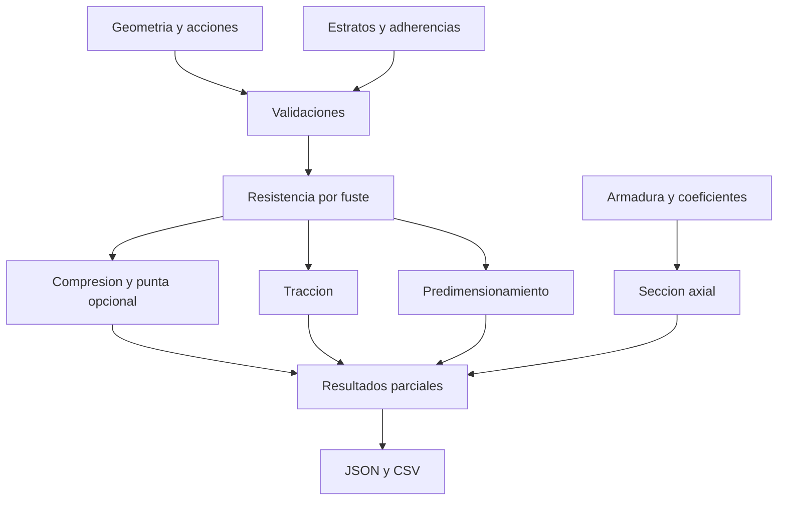

# Micropilotes | Geo_App

**Comprobacion geotecnica y estructural axial · Prototipo v0.4.1**


> [!IMPORTANT]
> No es una herramienta validada para proyecto. Las comprobaciones son parciales y requieren revision independiente y comprobacion de aplicabilidad de la guia y del marco contractual. El repositorio es publico: no introducir datos confidenciales en archivos versionados.

## Alcance
- Micropilote aislado, suelo estratificado, D nominal < 300 mm, inclinacion respecto a vertical.
- Resistencia por fuste a compresion y traccion separadas; curva opcional de punta maxima hipotetica +15% (no verificada, no usada en comprobaciones).
- Adherencias limite externas por CSV o entrada manual; seleccion de inyeccion por tramo, filtro conservador de presiones IU/IR/IRS y zona IU en primeros 5 m verticales.
- Predimensionamiento exacto por fuste con acciones constantes, sin punta ni peso favorable.
- Accion de rozamiento negativo de calculo aportada externamente, sin estimacion propia.
- Seccion tubular axial opcional sin barras adicionales, con seleccion parcial de dimensiones comerciales y entrada personalizada, reduccion radial por corrosion, factores de union, ejecucion y pandeo, y limites certificados de union opcionales.
- Calidades S235, S275, S355, S550, J55, K55 y N80 con limite elastico, resistencia a traccion y alargamiento de la tabla del catalogo Comercial de Sondeos (pagina 03). La seleccion es informativa: se debe introducir el limite elastico certificado por separado y confirmar disponibilidad para cada dimension.
- Tabla de aprovechamientos parciales, exportacion JSON/CSV y cinco pestanas de resultados graficos interactivos: perfil y adherencias efectivas, curvas de fuste por diametro nominal, contribucion por tramo, seccion transversal y comparacion parcial con seccion fija. SVG desde la barra de herramientas de cada figura; CSV de nodos de las curvas. Interfaz general de ocho pestañas y barrido regular por longitudes/diámetros, con acciones opcionales.
- Consulte el [diseno funcional](docs/DISENO_PARAMETRICO.md) para la estructura prevista de la aplicacion y las exportaciones.

## Metodologia
Referencia: [Guia para el proyecto y la ejecucion de micropilotes en obras de carretera, DGC, octubre 2005](https://cdn.transportes.gob.es/portal-web-transportes/carreteras/normativa_tecnica/08.1_guias_tecnicas/0710200.pdf).
Consulte [auditoria tecnica](docs/AUDITORIA.md), [hoja de ruta](ROADMAP.md) e [historial](CHANGELOG.md).

## Flujo


## Instalacion
Desde la raiz del repositorio:
```bash
cd micropilotes
python -m pip install -r requirements.txt
python -m streamlit run app.py
```
Para Streamlit Community Cloud: rama main, fichero micropilotes/app.py.

## Pruebas
```bash
cd micropilotes
python -m unittest discover -s tests -v
python -m compileall -q .
```
Las pruebas incluidas contrastan expresiones con calculos sinteticos independientes y limites; no equivalen a validacion fisica o normativa integral. Consultar el estado real de ejecucion en GitHub Actions si esta disponible.

## Intercambio
CSV UTF-8 separado por comas: nombre,espesor_m,inyeccion,adlim_kPa,fr,activo. Fr de tabla 3.2 (1.45 o 1.65) comun al micropilote. Adherencia de calculo automatica, sin doble minoracion. Si un tramo IR/IRS alcanza z < 5 m, se solicita su adherencia IU adicional; se muestra la tabla efectiva dividida. Las presiones se trasladan a un control avanzado opcional, y sin comprobacion numerica se registra la falta de verificacion numerica, sin casilla obligatoria. CSV antiguos con cotas, iu_kPa, seleccion_kPa y presiones siguen admitidos; se solicita Fr si falta. El JSON incluye profundidades, adherencias aplicadas y estado del control. Recarga JSON pendiente.

## Limitaciones
No se calculan asientos, estabilidad global, arrancamiento de un cono, flexion/cortante, cargas laterales, grupos, empotramiento en roca, conexiones al encepado ni rozamiento negativo de forma automatica. La justificacion de corrosion, pandeo, presiones por fases, ensayos y uniones sigue a cargo del proyectista. El catalogo contiene una seleccion parcial de dimensiones nominales y calidades de referencia de Comercial de Sondeos; no acredita combinaciones de dimensiones y calidades, existencias ni resistencia de uniones. No se reproducen cargas admisibles del catalogo.

**Geo_App · Ingenieria geotecnica y herramientas de calculo**

## Diseño paramétrico v0.4.1
Ocho pestañas generales: Proyecto, Geotecnia (incluye Configuración), Geometría, Compresión, Tracción, Estructural, Comparativas e Informes. Tabla 4.1 como selector, Dp inicialmente 1.10D editable. Barrido con extremos, paso y cambios de tramo e IU a 5 m verticales. Capacidad por fuste independiente de acciones; la hipótesis +15% se muestra separada sin uso en comprobaciones. El módulo estructural sigue siendo de una sección y diámetro principal, con parámetros manuales; no recalcula pandeo por longitud. Peso propio y rozamiento negativo no integrados en el barrido; considerar externamente. CSV/JSON/SVG disponibles. Excel/Word/PDF, recarga JSON y selección múltiple estructural pendientes. No se extrapola. Pruebas nuevas en tests/test_barrido.py; pendiente ejecución completa y prueba visual Streamlit.

## Interfaz v0.4.1
Configuración al comienzo de Geotecnia, importación CSV plegada, datos de entrada separados de resultados derivados (inicio/fin efectivo, longitud axial y adherencia admisible). Profundidad reconocida y máxima de cálculo visibles, sin extrapolación. Perfil completo sombreado bajo la punta y curvas aplicadas solo en tramos atravesados. Presentación numérica a dos decimales, sin redondear el motor ni los archivos de resultados. Ocho pestañas. Se mantienen las limitaciones y cálculos de v0.4.0. Pruebas específicas en tests/test_vista_geotecnica.py.

## v0.4.2 — Armaduras comerciales
Catálogo completo de 74 secciones CS550/CSTM80 (p. 06 del catálogo facilitado); carga comercial en tf y kN, no Rd. Sección 273 × 6 sin carga publicada. Propiedades tabuladas conservadas; área resistente geométrica residual calculada por separado. Calidades de tabla 2.1 y catálogo p. 03, fy certificado opcional común; N80 usa mínimo. Selección múltiple y personalizada, recubrimiento 2.3, corrosión 2.4, unión 3.4/3.7, ejecución 3.5 y CR 3.6. Sin coacción definida no hay límite de cálculo. Envolvente parcial por acero solo, con factores y sin punta, comparada con capacidad compuesta opcional si inferior; no sustituye revisión de pandeo, uniones ni certificado. Datos de unión y corrosión comunes a alternativas: usar valores prudentes o analizar por separado. Gráficas y tablas en compresión/tracción/comparativas; exportación CSV y JSON de alternativas. Pruebas específicas en tests/test_catalogo_completo.py.
