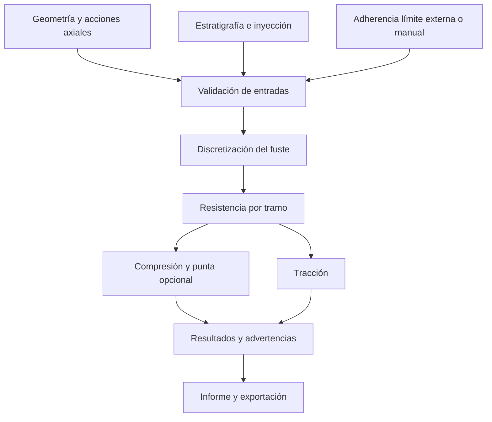

# Micropilotes | Geo_App

**Cálculo geotécnico axial mediante correlaciones empíricas**


## 1. Objetivo

Aplicación de ingeniería geotécnica para la comprobación y el futuro predimensionamiento de micropilotes aislados sometidos a esfuerzos axiales, basada en el método de las correlaciones empíricas de la Dirección General de Carreteras.

El proyecto separa el motor de cálculo de la interfaz gráfica para facilitar su mantenimiento, verificación y ampliación.

> [!IMPORTANT]
> **Estado: prototipo v0.1.0.** Código Python incorporado. Las cuatro pruebas originales del motor pasan localmente (24/11/2026). No se ha completado la auditoría normativa ni la verificación visual de Streamlit. No constituye una herramienta validada para proyecto.

## 2. Alcance técnico

| Funcionalidad | Alcance previsto |
| --- | --- |
| Tipología | Micropilote aislado en terreno estratificado |
| Geometría | Longitud axial, diámetro nominal e inclinación respecto a la vertical |
| Compresión | Resistencia geotécnica por fuste y punta opcional justificada |
| Tracción | Resistencia por fuste; tratamiento separado de cargas alternas y peso propio favorable |
| Inyección | IU, IR e IRS, respetando sus condiciones de aplicación |
| Adherencia límite | Valores aportados por el usuario o por una aplicación externa de correlaciones |
| Unidades | kN, m y kPa |
| Interfaz | Streamlit |
| Resultados | Resistencias por tramo, comprobaciones independientes y aprovechamientos |

No se incluye inicialmente la comprobación estructural de la armadura, el pandeo, la interacción entre micropilotes, las cargas transversales, los asientos ni la estabilidad global.

## 3. Referencia técnica y metodología

Referencia principal: [Guía para el proyecto y la ejecución de micropilotes en obras de carretera](https://cdn.transportes.gob.es/portal-web-transportes/carreteras/normativa_tecnica/08.1_guias_tecnicas/0710200.pdf), Dirección General de Carreteras, especialmente los apartados 3.3.1, 3.3.2.4 y 3.3.3, y la figura 3.3.

Para el cálculo por fuste en compresión, el esquema adoptado es:

$$
r_{fc,d,i}=\frac{r_{f,\mathrm{lim},i}}{F_r}
$$

$$
R_{fc,d}=\sum_i \pi D_i L_i r_{fc,d,i}
$$

Donde:

- $D_i$: diámetro nominal de cálculo del tramo, en m.
- $L_i$: longitud del tramo a lo largo del eje, en m.
- $r_{f,\mathrm{lim},i}$: rozamiento unitario límite, en kPa.
- $F_r$: coeficiente de minoración aplicable según la guía.
- $R_{fc,d}$: resistencia de cálculo por fuste a compresión, en kN.

El motor deberá distinguir longitud axial y profundidad vertical, discretizar los cambios de estrato y aplicar el criterio de inyección IU en los primeros 5 m de profundidad vertical conforme a la guía.

La punta estará desactivada por defecto. Solo podrá considerarse en compresión cuando se justifique su resistencia y se verifiquen las condiciones de aplicación:

$$
R_{c,d}=R_{fc,d}+R_{p,d}
\qquad
R_{p,d}\leq 0{,}15 R_{fc,d}
$$

El 15 % es un límite máximo, no una resistencia automáticamente movilizable.

La tracción se evaluará mediante una comprobación independiente, con los coeficientes específicos aplicables y, cuando proceda, el peso propio favorable debidamente minorado.

## 4. Flujo de trabajo previsto (exportación pendiente)



Los valores de adherencia se mantendrán trazables, incluyendo su origen, unidades, tipo de inyección y justificación. La integración automática con la aplicación externa queda pendiente de definir su formato de intercambio.

## 5. Arquitectura prevista (módulos pendientes: datos, servicios y visualización)

```text
micropilotes/
├── app.py                 # Interfaz Streamlit
├── calculos/              # Motor de cálculo geotécnico
├── modelos/               # Datos de entrada y resultados
├── datos/                 # Datos y referencias verificadas
├── servicios/             # Importación, proyectos e informes
├── visualizacion/         # Perfil estratigráfico y gráficos
├── tests/                 # Pruebas unitarias y de regresión
├── requirements.txt       # Dependencias
└── README.md              # Documentación técnica
```

## 6. Instalación y ejecución

Desde la raíz del repositorio, ejecutar:

```bash
cd micropilotes
python -m pip install -r requirements.txt
python -m streamlit run app.py
```

Pruebas incluidas (sin dependencia adicional):

```bash
python -m unittest discover -s tests -v
```

Para un futuro despliegue en Streamlit Community Cloud, el punto de entrada será `micropilotes/app.py`, previa configuración y verificación de las dependencias.

## 7. Plan de desarrollo y validación

- [x] Definición del alcance inicial y referencia técnica.
- [x] Inicialización de la documentación en GitHub.
- [x] Incorporación del prototipo Python.
- [x] Ejecución de las cuatro pruebas originales del motor.
- [ ] Auditoría técnica completa del prototipo.
- [ ] Verificación independiente de compresión y tracción, coeficientes y unidades.
- [ ] Casos de ensayo: estrato único, multiestrato, inclinación, cruce de 5 m, cavidades y punta opcional.
- [ ] Verificación funcional de la interfaz Streamlit.
- [ ] Integración con la aplicación externa de adherencias límite.
- [ ] Predimensionamiento de longitud y exportación de resultados.
- [ ] Incorporación de perfiles tubulares comerciales (CS550, CSTM80 y otros) con trazabilidad de catálogo.
- [ ] Módulo independiente de comprobación estructural, uniones y durabilidad.

## 8. Control de calidad y limitaciones

En v0.1.0 la entrada de adherencia límite es manual. Puede proceder de la herramienta externa, indicando la referencia y justificación. La comprobación de las condiciones de punta es manual; el motor controla su justificación declarada y el límite del 15 %. La tabla inicial contiene valores ilustrativos, no datos reales. Los coeficientes implementados y su aplicabilidad requieren revisión independiente contra la guía. No hay todavía exportación, selección de tuberías ni predimensionamiento automático.

El cálculo empírico no sustituye las pruebas de carga representativas, la investigación geotécnica ni el juicio profesional. Los resultados deberán revisarse conforme al marco normativo y los pliegos aplicables a cada obra.

Las condiciones de aplicabilidad de la guía, las hipótesis, los coeficientes y las unidades deberán quedar reflejados en los resultados. La capacidad geotécnica y la estructural se mantendrán diferenciadas.

## 9. Versionado

Se propone versionado semántico y cambios trazables mediante commits. Las versiones no se considerarán aptas para uso de proyecto hasta completar las verificaciones correspondientes.

La documentación y el código se mantienen en [me1lopig/Exterior](https://github.com/me1lopig/Exterior).

---

**Geo_App · Ingeniería geotécnica y herramientas de cálculo**
